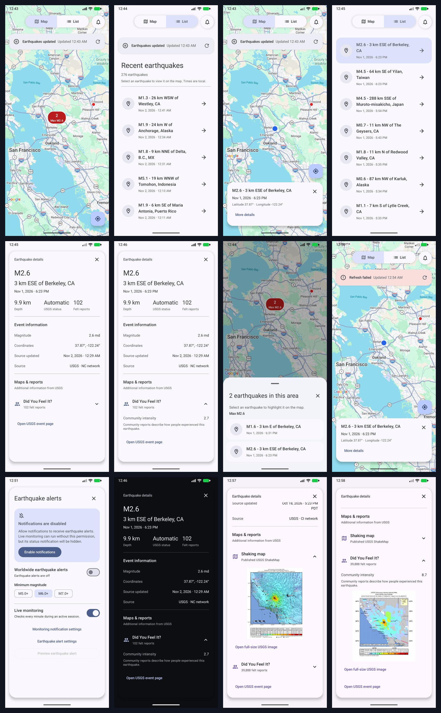
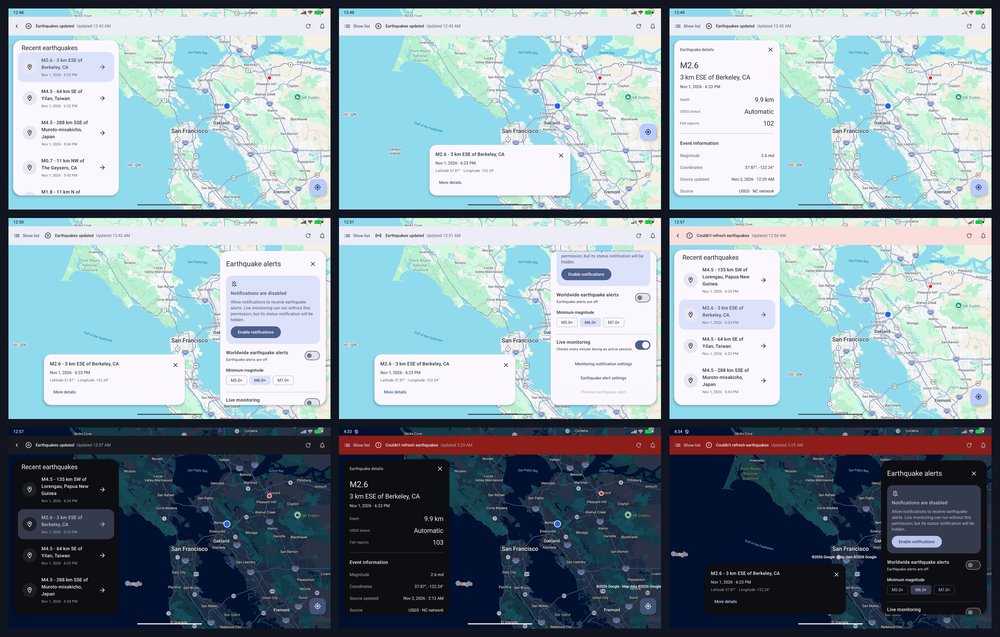
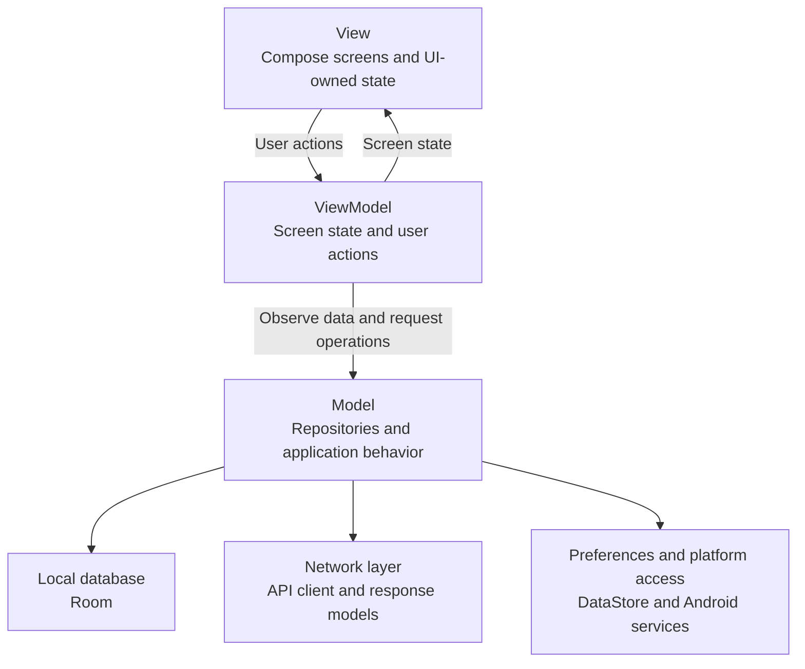
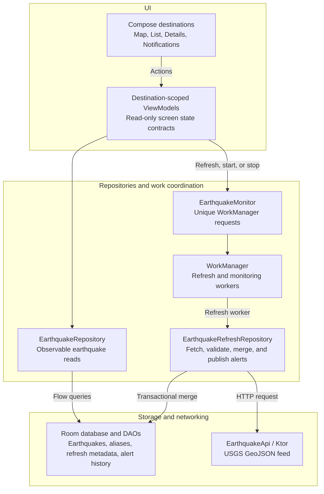
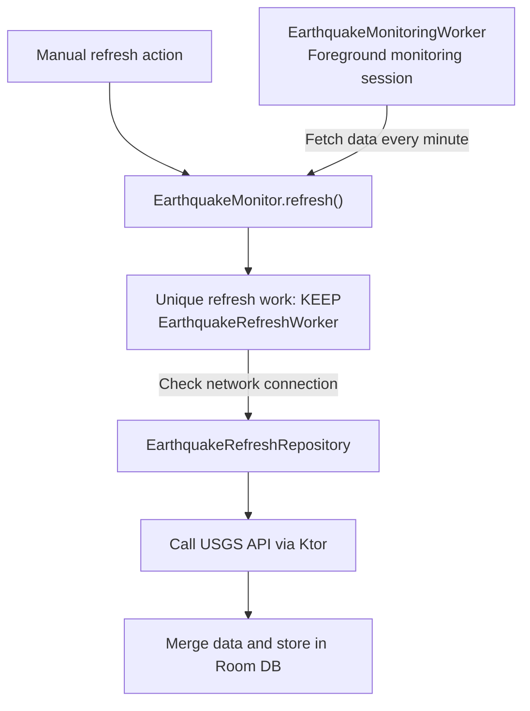
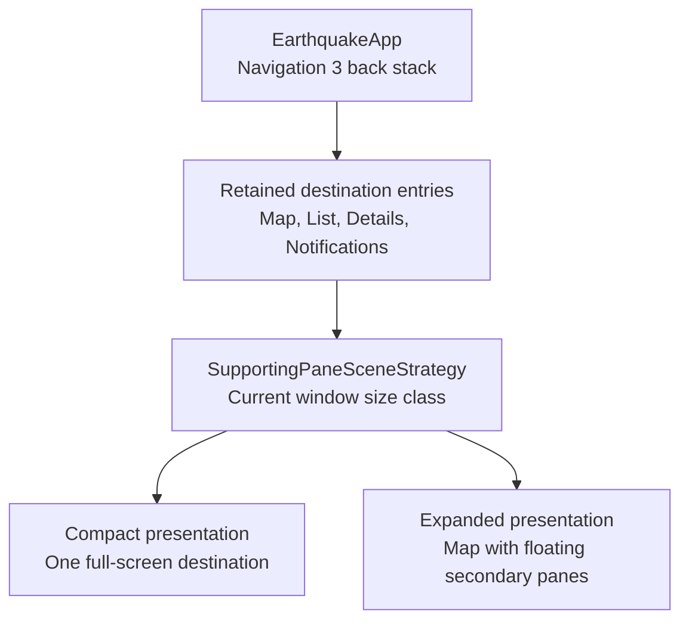

# Earthquake Tracker

Earthquake Tracker is an Android app for viewing earthquake activity from the
USGS Earthquake API.

## Features

Explore earthquakes in Map and List, open event details, and keep saved data
available offline with manual refresh, live monitoring, and optional alerts.
Foldable and resizable windows adapt between full-screen views and floating
panes while preserving selection and view state.

See the [full feature inventory](docs/features.md).

**Compact layouts**



**Expanded layouts**



The ShakeMap and DYFI images show the fixed-event report-image prototype.
Report-image discovery is not yet connected to normal event selection.

## Setup and run

### Requirements

- Android Studio with support for the project's Android Gradle Plugin version.
  The project currently uses AGP 9.1.1 and Android SDK Platform 37.
- An Android device or emulator running Android 8.0 / API 26 or newer, with
  Google Play services for Maps.
- A Google Maps API key with Maps SDK for Android enabled and billing configured
  for its Google Cloud project.
- Network access for initial dependency downloads, earthquake updates, and map
  tiles.

Use the included Gradle wrapper. Gradle selects or downloads the required JDK 21.
For terminal builds, an existing Java runtime must be available through
`JAVA_HOME` or `PATH`; Android Studio's bundled runtime can start Gradle.

### Configure Maps

Follow the [Maps key setup instructions](docs/building.md#get-a-google-maps-api-key)
to create a key. Add it to your user-level `~/.gradle/gradle.properties`:

```properties
MAPS_API_KEY=PASTE_YOUR_KEY_HERE
```

The repository's ignored `local.properties` is also supported. Keep its existing
SDK configuration when adding the key. A Gradle property takes precedence over
the local file, and a missing or blank key fails build configuration. Keep real
keys out of tracked files.

### Launch the app

1. Open the repository in Android Studio and install the SDK packages requested
   during sync.
2. Sync the project after configuring the Maps key.
3. Select the `app` configuration and a compatible device, then click **Run**.
4. Tap **Refresh** to load earthquake information. Opening Map or List reads
   saved data and does not automatically fetch updates.
5. Open **Notifications** if you want to enable alerts or start live monitoring.
   Location and notification permissions are optional for browsing earthquakes.

To build from a terminal:

```sh
./gradlew :app:assembleDebug
```

The APK is written to `app/build/outputs/apk/debug/app-debug.apk`. The
[build guide](docs/building.md) covers installation, Maps configuration, and
troubleshooting. The [Android CLI guide](docs/android-cli.md) covers terminal
installation and launch commands.

Check Maps access and earthquake loading separately: geographic tiles and labels
should appear on the map, and a successful refresh should populate earthquake
information. A successful build alone does not verify Maps authorization.

On the shared development host, device validation uses the reserved
**Earthquake Project** emulator: Resizable, API 37, Google Play. Follow the
[shared emulator workflow](docs/testing.md#shared-test-emulator) before using it.

## Architecture

The app currently uses MVVM across a single `:app` module. Packages group the Map, List,
Details, and Notifications features, with separate packages for navigation,
shared presentation, repositories, networking, persistence, notifications, and
background work.

MVVM organizes screen state and user actions. The Model side includes repository
behavior and its data sources. Room, networking, and preferences sit beneath
that boundary:



### How this applies to the project

Each destination has its own ViewModel and read-only state contract. ViewModels
collect repository Flows and expose Compose-backed state. Rendering components
receive presentation values and callbacks, which also lets previews and tests
render them with deterministic state implementations.

Earthquake reads and updates follow separate paths. `EarthquakeRepository`
observes Room. Refresh actions enqueue WorkManager requests, whose worker calls
`EarthquakeRefreshRepository` to fetch and save updates. The screens continue
observing the database throughout that operation.

The arrows below show calls and dependencies from presentation down to its data
sources. Database observations and screen state propagate back up those paths.



These boundaries keep Map, List, and Details consistent with the same saved data.
A failed request leaves the database observation and previously saved records
available. Refreshing never replaces the UI's history with a temporary network
response.

Hilt provides the shared Ktor client, Room database, DataStore, dispatchers, and
worker dependencies. Settings and location repositories use DataStore for small
persisted values. The location provider wraps Fused Location Provider updates;
`EarthquakeNotifications` owns Android notification channels and posting.

### State ownership

| Owner | Responsibility |
| --- | --- |
| Navigation host | Back stack, compact view choice, expanded panel visibility, open Details ID, and pending selection-result delivery. |
| Destination ViewModel | Feature state, selected event, pending camera or scroll requests, and the last applied selection revision. Restorable values use `SavedStateHandle`. |
| Destination UI | Camera position, list scroll position, layout measurements, permission launchers, and locale-dependent formatting. Saveable UI state stays with its navigation entry. |
| Room | Earthquake records, known source IDs, refresh metadata, and delivered-alert history. |
| DataStore | Alert preferences, permission-request history, and the last measured location. Android remains the authority for permission grants. |

Map and List communicate through revisioned navigation results. Each applies a
selection to its own state and ignores older revisions. The host retains pending
results until the receiving destination can consume them, including when that
destination is hidden. This preserves independent destination lifetimes while
keeping their selections synchronized.

See the [architecture guide](docs/architecture.md) for the implementation
conventions and source examples.

## Refresh and monitoring

An individual refresh and a monitoring session are separate units of work.
`EarthquakeMonitor` schedules both and exposes their WorkManager observations.



Manual refresh and monitoring jobs share the unique `earthquake_refresh`
request with `ExistingWorkPolicy.KEEP`. WorkManager retains an existing pending
or running refresh instead of starting an overlapping one.

The monitoring worker uses `setForeground` with the `dataSync` service type. It
requests a refresh immediately, waits for the enqueue operation to complete,
then delays one minute before the next request. It does not wait for the refresh
itself to finish. Stopping monitoring cancels future checks while an already
queued or running refresh can finish independently.

The refresh worker first checks for a validated active network. Without one, it
fails immediately. Otherwise, the refresh repository downloads the past-day
feed, validates it, and merges records and the successful-refresh timestamp in
one Room transaction. Newer source revisions update existing records; records
absent from a later feed remain saved. Source aliases preserve lookup when a
preferred event ID changes.

`EarthquakeMonitoringObserver` combines the two workers' `WorkInfo` observations
with stored-data availability and the last successful refresh time. The in-app
banner shows the latest refresh request's state. Monitoring controls and the
foreground notification describe the separate session.

Android can delay or stop work, so monitoring's minute interval is a requested
cadence. A failed offline refresh does not end the session, and reconnection
waits for the next scheduled check. Further data behavior is described in the
[earthquake data guide](docs/earthquake-data.md).

## Navigation and adaptive layouts

`EarthquakeApp` owns a Navigation 3 back stack with serializable keys for Map,
List, Details, and Notifications. Entry decorators retain each destination's
ViewModel store and saveable UI state. Switching Map and List reuses their
existing keys.

Material Adaptive's `SupportingPaneSceneStrategy` presents those entries using
the current window size class:



| Destination | Pane role | Expanded presentation |
| --- | --- | --- |
| Map | `mainPane` | Fills the window beneath the controls and floating panes. |
| List | `supportingPane` | Floats over the map at the bottom-start edge; can be minimized. |
| Details | `supportingPane` | Replaces List in the same pane. Close or Back returns to the retained List. |
| Notifications | `extraPane` | Floats over the map at the bottom-end edge. Temporarily hides List or Details and restores it when closed. |

The layout follows the app's current window size through
`currentWindowAdaptiveInfoV2().windowSizeClass`. AndroidX classifies the available
width and height separately. These [window size classes](https://developer.android.com/develop/ui/compose/layouts/adaptive/use-window-size-classes)
update as the app's window changes, including during resizing, split-screen use,
or folding.

We show floating panes when the window has expanded-or-larger width and
medium-or-larger height. The code uses AndroidX's breakpoint constants, currently
840 dp wide and 480 dp tall. The width requirement leaves room for a pane and
the map, while the height check keeps wide but short windows in the full-screen
presentation.

[`AdaptStrategy.Levitate`](https://developer.android.com/reference/kotlin/androidx/compose/material3/adaptive/layout/AdaptStrategy.Levitate)
draws the active secondary pane as a floating overlay above the map. This keeps
the map at full size behind the pane. List and Details use `Alignment.BottomStart`;
Notifications uses `Alignment.BottomEnd`. These place the cards at the lower
left and lower right respectively in a left-to-right layout, below the top app
bar, and mirror in right-to-left layouts. We omit a dimming scrim so the exposed
map remains interactive.

For smaller or shorter windows, `AdaptStrategy.Hide` hides the secondary panes
from the shared map layout, and the navigation scene presents the current
destination full-screen.

Folding or resizing changes the presentation while retaining the destination
entries. Camera position, list scrolling, selection, and an open detail event
stay with their existing owners. Explicit **More details** actions open Details;
ordinary marker and row selections keep their selection behavior.

## Testing

Tests use fixed earthquake fixtures and controlled network responses. Different
suites exercise persistence, work scheduling, navigation, and rendering at their
own boundaries.

| Suite | What it covers |
| --- | --- |
| Unit tests | API requests and decoding with Ktor MockEngine, alert rules and deduplication, preferences, location persistence, timestamp conversion, and cluster summaries. |
| Database and refresh integration | Real Room reads and writes, observable updates, source revisions and aliases, retained history, transaction rollback, failed refreshes, and reopening storage. |
| Worker and platform tests | WorkManager scheduling and cancellation, offline failure, monitoring continuity, Android notification channels, permissions, and foreground status. |
| Compose behavior and navigation | Selection results, pane changes, resize boundaries, saved-state restoration, scrolling, cluster interaction, and component actions. |
| Screenshot tests | Deterministic Compose components across supported visual states and representative light, dark, narrow, large-text, expanded, and RTL configurations. |
| Native Maps checks | Device tests for markers, clusters, camera behavior, and overlay clearance, plus manual inspection of real map rendering. |

For example, `EarthquakeRefreshIntegrationTest` combines the real refresh worker,
repository, Room database, and preferences with a MockEngine feed.
`EarthquakeNavigationTest` runs the real navigation host with controlled
destination content to check result delivery and retained owners across layout
changes.

Configure the Maps key before running Gradle checks. Host checks include:

```sh
./gradlew :app:assembleDebug :app:testDebugUnitTest :app:lintDebug
./gradlew :app:validateDebugScreenshotTest
```

Kotlin formatting uses the standalone ktfmt CLI described in the
[formatting guide](docs/formatting.md). Device tests use the shared API 37
emulator under the [testing guide's reservation workflow](docs/testing.md#shared-test-emulator).
That guide also provides the separate offline and online native-Map test
commands and their preconditions.

Host screenshot tests cover app-owned Compose content, including marker artwork.
They do not cover the native Google Maps surface or Android permission dialogs.
Native map screenshot regression coverage remains missing. Complete app flows
and more complex combinations of Compose states are also areas for further
coverage.

## Assumptions and tradeoffs

Room is the source of truth for earthquake data. Network refreshes write updates
to Room. ViewModels observe Room through repository Flows and expose state to
the UI, which updates when the stored data changes.

Every runtime earthquake refresh goes through the same unique WorkManager job,
including manual refreshes while the app is open. We use
[`ExistingWorkPolicy.KEEP`](https://developer.android.com/develop/background-work/background-tasks/persistent/how-to/manage-work)
to retain an existing pending or running refresh instead of starting another
one. This gives manual refresh and monitoring jobs one update path.

WorkManager is therefore a core component of the app. We rely on its scheduling
to start updates and its work state to report their progress. This ties the
update orchestration to Android. Sharing that orchestration as multiplatform
business logic would require a platform-specific scheduler with equivalent
support for unique work, cancellation, and observable status. Data models and
pure policies could still be shared independently.

Going through WorkManager adds enqueueing, work persistence, scheduling, and
worker startup to the request path. We have not measured the added overhead
compared with calling the API directly. Our assumption is that it is acceptable
for the current feed responses and a refresh interval of roughly one minute.
A continuous data stream, more frequent updates, or strict latency requirements
would require us to revisit this approach.

We want to benchmark the delay from requesting a refresh to starting its network
call, separately from the network and database time. Comparing the worker path
with a direct call to the same refresh repository, using controlled responses,
would help establish how much latency comes from WorkManager.

## Future Improvements

### Migrate long-term monitoring into a dedicated foreground service

We currently use WorkManager with `setForeground` to manage long-term updates, even when the app
might not be active. This was originally done to avoid additional configuration, as we already
planned to use WorkManager to handle background/unique work when a refresh is triggered. Even though
this is backed by a notification foreground service internally, it is still subject to work quotas,
starting on Android 16.

Android 16 applies job quotas to long-running WorkManager workers, including
workers running in the foreground. A directly managed service can move the
session lifetime outside that job quota, while any retained refresh jobs still
use WorkManager. A `dataSync` service also remains subject to foreground-service
runtime limits. See Android's [long-running worker guidance](https://developer.android.com/develop/background-work/background-tasks/persistent/how-to/long-running)
and [foreground-service timeouts](https://developer.android.com/develop/background-work/services/fgs/timeout).

### Surface more specific error feedback

Refresh failures currently share generic messaging. Add distinct feedback and
recovery actions for offline access, API unavailability, and Android scheduling
restrictions, with a fallback when the cause is unknown. Quota restrictions can
stop or delay work; they should be identified from available scheduling and
[stop-reason information](https://developer.android.com/reference/androidx/work/WorkInfo),
rather than inferred from any queued or failed request.

### Testing more end-to-end app flows

Add tests that launch the production app and follow complete journeys with
controlled feed responses: refresh to Map/List to Details, resize while an event
is selected, reopen after an offline failure, and start or stop monitoring.
Existing component and integration tests cover parts of these journeys.

### More complex Compose states

Extend behavior and screenshot coverage for interacting states and transitions,
including refresh outcomes alongside permission changes, pane replacement,
resizing, and restoration. Verify both the visible result and the state retained
when a destination returns.

### Performance benchmarks

Add [Macrobenchmark](https://developer.android.com/topic/performance/benchmarking/macrobenchmark-overview)
tests for startup, scrolling, and navigation. Add
[Microbenchmark](https://developer.android.com/topic/performance/benchmarking/microbenchmark-overview)
tests for isolated code such as response decoding and mapping.

Also measure WorkManager's added delay before a refresh starts its network call.
Every update goes through WorkManager, including manual refreshes while the app
is open. We want to measure how much enqueueing, persisting work, scheduling, and
starting the worker add compared with calling the refresh repository directly.

Compare both paths with equivalent connectivity checks, the same Ktor client,
controlled responses, decoding, and Room writes. Record when the refresh is
requested, the worker starts, the network call starts and finishes, Room saves
the data, and the UI displays it. Measure worker completion separately from data
availability, and separate time waiting for Android to schedule work from time
spent executing it.

Cover first and repeated requests, foreground and background execution, and
cases where unique work is already pending or running. With `KEEP`, another
request can reuse existing work without starting a new network call. Report
reused requests separately from new work. Measure typical delays and slower
runs, and check CPU and battery cost at the intended one-minute cadence. A small
feed and a one-minute refresh interval do not establish an acceptable delay for
a manual refresh.

### Release R8 optimization

Enable [R8 code and resource optimization](https://developer.android.com/topic/performance/app-optimization/enable-app-optimization)
for release builds, including shrinking and obfuscation. Review library rules
and add focused keep rules where needed. Check that the optimized build can
start workers, read Room data, and decode API responses. Run app performance
benchmarks against a build with the same release optimizations.

### Continue to improve and optimize AI instructions and skills

Make instructions more specific so multiple AI agents can develop features
and run independent checks in parallel. Define task ownership, separate
worktrees, isolated test data and build outputs, and how changes are reviewed
and integrated. Investigate isolated device-test environments so app flows can
also be tested in parallel without sharing installed app state. Device tests
currently share one emulator and run one at a time, while other agents can
continue implementation and host checks.

Add focused skills for extending network APIs, adding Room entities and tables,
and introducing future database migrations. Make UI conventions more specific
around state ownership, navigation, adaptive layouts, and shared components.
Each skill should link to working source examples and identify the checks
appropriate to the change, including storage, migration, and screenshot coverage
where relevant.

### Dedicated design system

Build on the current Material theme and reusable components with semantic color
tokens, shared spacing and padding values, and common component styling. This
would give map selection, refresh feedback, cards, rows, and controls a
consistent set of design decisions across window sizes and themes.

### Feature and infrastructure modules

Split the current `:app` module into feature modules and shared modules for
work scheduling, notifications, networking, database access, and the design
system. The existing packages provide starting boundaries; the next step is to
define module dependencies and public interfaces so those boundaries are
enforced by the build.

### Search and filters

Add search and filters to explore earthquakes in more detail. Filter by
magnitude, show earthquakes closest to the user, or limit results to the current
map viewport. These will all provide useful, contextual information to the user, especially
in combination with their current location data.

### Optimize foldable/expanded layout

Revisit the top app bar for expanded windows on foldable and resizable devices.
Showing List over Map led us to replace the compact Map/List toggle with separate
Show list and Minimize controls. Those controls need more design work, and the
different presentations have made the layout code more complex. Find a clearer
way to show and hide the list while keeping the map visible, and simplify the
code that handles the two layouts.

### More detailed permission rationale UI

Location and notification requests currently have basic rationale dialogs for the re-request flow,
when Android reports that a rationale should be shown. First requests go straight to the system
permission dialog.

Add more detailed, permission-specific UI explaining why access is needed, what it enables, and
which features remain available if the user declines. Give the initial request, a previous denial,
and recovery through Settings distinct messages and actions. Use
`shouldShowRequestPermissionRationale()` alongside request history to choose the right state, and
let users dismiss the explanation without immediately triggering another system prompt. See
[Android's permission guidance](https://developer.android.com/training/permissions/requesting).

### Analytics and crash reporting

Tests and local validation currently provide our main feedback on reliability. Integrate
[Firebase Crashlytics](https://firebase.google.com/docs/crashlytics)
for production crash and non-fatal error reporting, including device-specific failures that may not
appear during local testing.

Add analytics events for feature usage, including how often users enable or disable notifications.
Use [OpenTelemetry-compatible instrumentation](https://opentelemetry.io/docs/what-is-opentelemetry/)
and a telemetry backend to centralize feature events, logs, metrics, and traces, with spans around
refreshes and other key operations. Propagate
[trace context](https://opentelemetry.io/docs/concepts/context-propagation/)
between the app and any future instrumented backend services so requests can be followed across
both.

## Other helpful documents

The [project instructions](AGENTS.md) link to formatting, coding, architecture,
source control, and testing conventions. Use the [build guide](docs/building.md)
for setup and the [testing guide](docs/testing.md) for verification commands and
device requirements.
