# Features

All features currently live in the `:app` module. Each section links to the
relevant implementation and shows full-screen captures in compact and expanded
windows. Select an image to open the full-resolution capture. The screenshots
use saved USGS events; event counts and update times change with the feed.

Return to the [README](../README.md).

## Map

Select individual earthquakes or browse clusters with event counts and maximum
magnitude. A cluster opens a scrollable sheet of its members, including events
at identical coordinates.

Implementation:

- Map rendering and clustering: [EarthquakeMap.kt](../app/src/main/kotlin/com/johnturkson/sandbox/ui/map/EarthquakeMap.kt).
- Selection state: [EarthquakeViewModel.kt](../app/src/main/kotlin/com/johnturkson/sandbox/ui/map/EarthquakeViewModel.kt).
- Cluster member sheet: [EarthquakeClusterSheet.kt](../app/src/main/kotlin/com/johnturkson/sandbox/ui/map/cluster/EarthquakeClusterSheet.kt).

**Compact**

[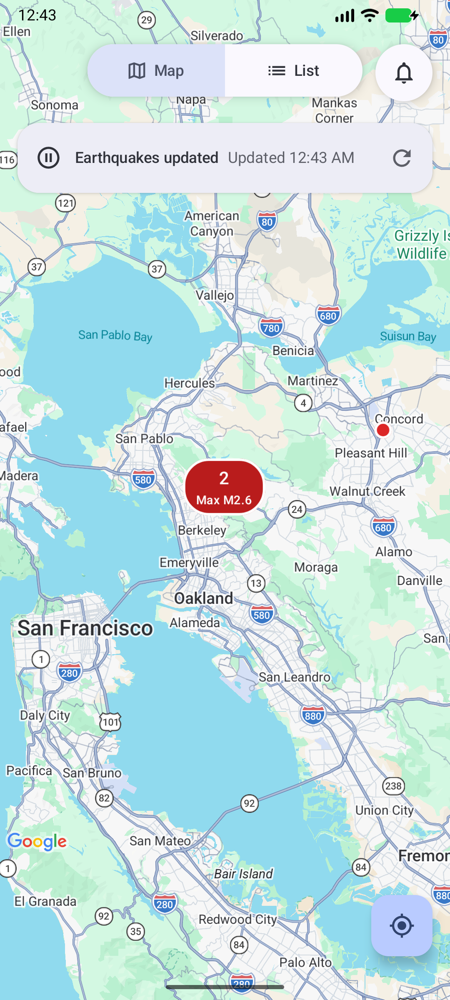](images/walkthrough/compact-map.png)

**Expanded**

[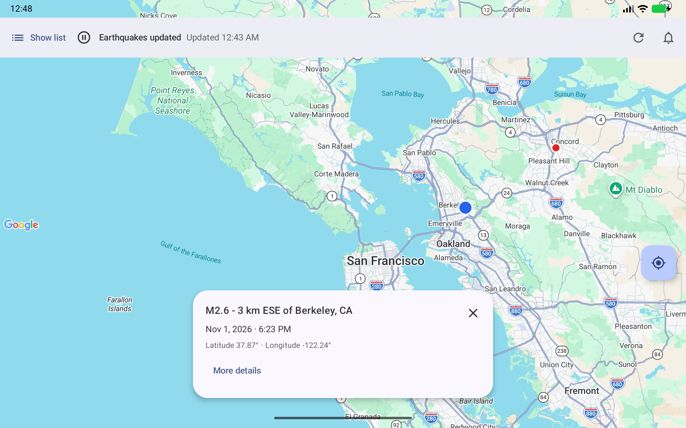](images/walkthrough/expanded-minimized.png)

**Cluster members**

[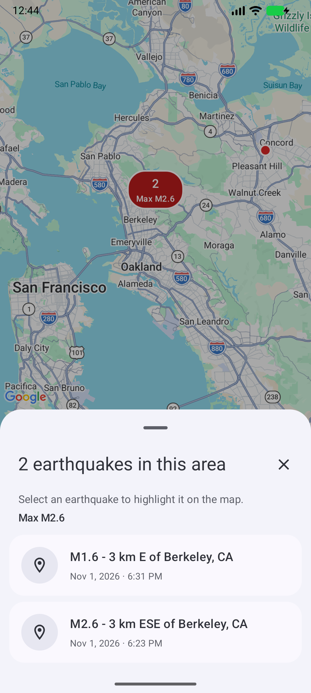](images/walkthrough/compact-cluster.png)

## List

Browse saved earthquakes with magnitude, place, and local event time. Selecting a
row focuses that event on Map; selecting a map event highlights and reveals its
list row. The separate arrow opens Details.

Implementation:

- Destination and list presentation: [EarthquakeListScreen.kt](../app/src/main/kotlin/com/johnturkson/sandbox/ui/list/EarthquakeListScreen.kt).
- Selection and pending row reveal: [EarthquakeListViewModel.kt](../app/src/main/kotlin/com/johnturkson/sandbox/ui/list/EarthquakeListViewModel.kt).
- Event rows and detail actions: [EarthquakeListRow.kt](../app/src/main/kotlin/com/johnturkson/sandbox/ui/event/EarthquakeListRow.kt).

**Compact**

[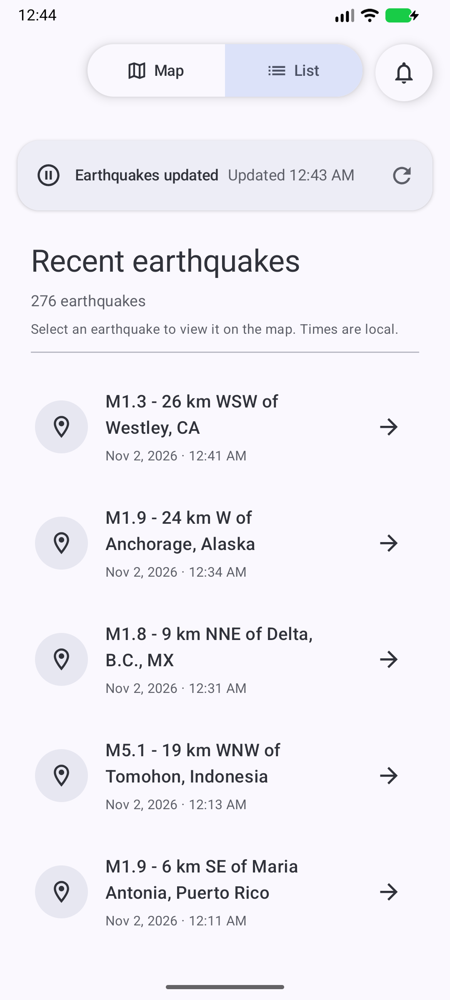](images/walkthrough/compact-list.png)

**Expanded**

[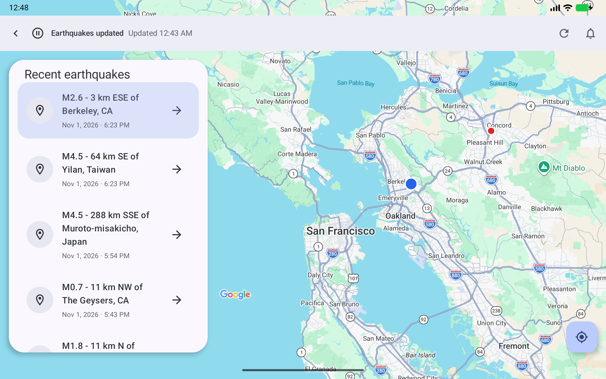](images/walkthrough/expanded-list.png)

## Details

View magnitude, location, time, depth, review status, felt reports, community
intensity, coordinates, and source information. Open the event's USGS page for
more information. Details reads the saved event without making another API
request.

Implementation:

- Detail card, event fields, and report sections: [EarthquakeDetailsScreen.kt](../app/src/main/kotlin/com/johnturkson/sandbox/ui/details/EarthquakeDetailsScreen.kt).
- Saved-event lookup and presentation state: [EarthquakeDetailsViewModel.kt](../app/src/main/kotlin/com/johnturkson/sandbox/ui/details/EarthquakeDetailsViewModel.kt).
- Report image component used by the prototype: [EarthquakeReportImage.kt](../app/src/main/kotlin/com/johnturkson/sandbox/ui/details/reports/EarthquakeReportImage.kt).

**Compact**

[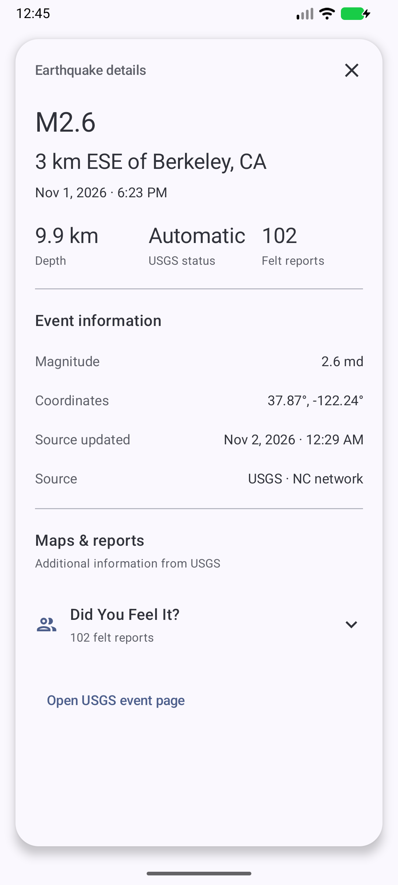](images/walkthrough/compact-details.png)

**Expanded**

[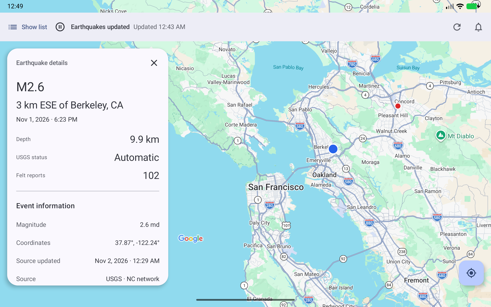](images/walkthrough/expanded-details.png)

## Foldable and resizable layouts

Compact windows show one destination at a time. Expanded windows keep Map
visible under floating List, Details, or Notifications panes, and let the user
minimize and restore List. Resizing or folding retains selection, camera
position, list scrolling, and the open detail event.

Implementation:

- Window size classes and Navigation 3 scenes: [EarthquakeApp.kt](../app/src/main/kotlin/com/johnturkson/sandbox/ui/navigation/EarthquakeApp.kt).
- Compact controls and expanded top app bar: [EarthquakeControls.kt](../app/src/main/kotlin/com/johnturkson/sandbox/ui/layout/EarthquakeControls.kt).
- Floating pane rendering: [EarthquakePaneOverride.kt](../app/src/main/kotlin/com/johnturkson/sandbox/ui/layout/EarthquakePaneOverride.kt).

**Compact**

[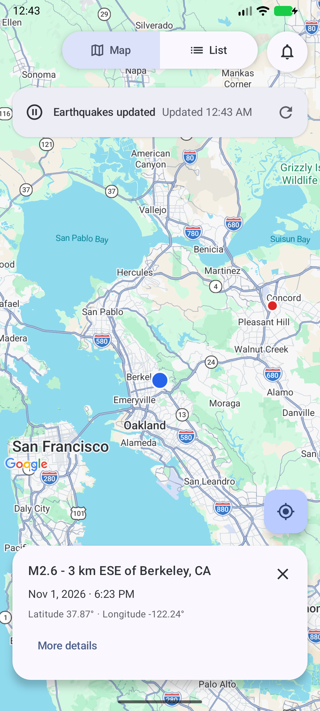](images/walkthrough/compact-selection.png)

**Expanded**

## Refresh

Request an update and see the latest refresh request's queued, running,
successful, failed, or cancelled state. The last successful update time stays
visible independently of that state. Existing information remains available
during a refresh or after failure.

Implementation:

- Unique refresh scheduling: [EarthquakeMonitor.kt](../app/src/main/kotlin/com/johnturkson/sandbox/work/EarthquakeMonitor.kt).
- Connectivity check and refresh execution: [EarthquakeRefreshWorker.kt](../app/src/main/kotlin/com/johnturkson/sandbox/work/EarthquakeRefreshWorker.kt).
- API fetch and Room merge: [EarthquakeRefreshRepository.kt](../app/src/main/kotlin/com/johnturkson/sandbox/data/repository/EarthquakeRefreshRepository.kt).
- Refresh status observed by the UI: [EarthquakeMonitoringObserver.kt](../app/src/main/kotlin/com/johnturkson/sandbox/ui/monitoring/EarthquakeMonitoringObserver.kt).

**Compact**

[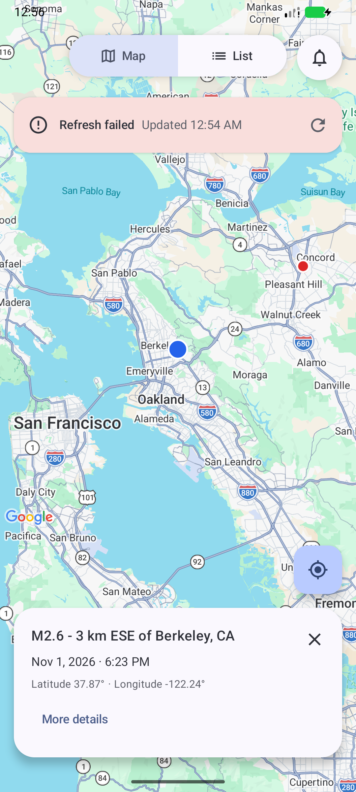](images/walkthrough/compact-offline.png)

**Expanded**

[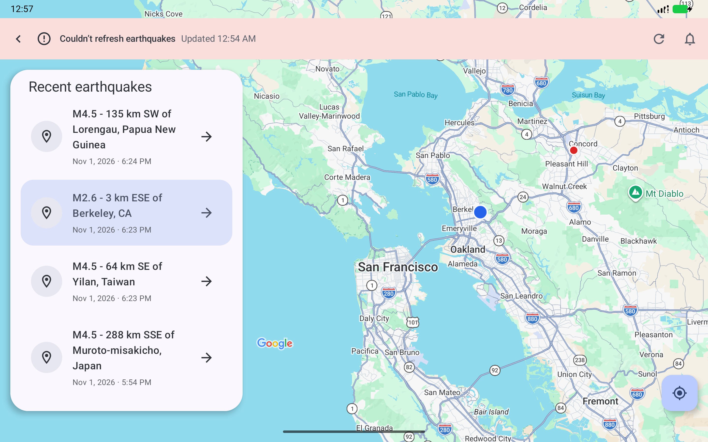](images/walkthrough/expanded-offline.png)

## Live monitoring

Start or stop a foreground monitoring session from Notifications. It requests an
immediate refresh, then checks approximately once a minute through the same
unique refresh job. Stopping the session leaves an already queued or running
refresh free to finish.

Implementation:

- Monitoring session loop and foreground status: [EarthquakeMonitoringWorker.kt](../app/src/main/kotlin/com/johnturkson/sandbox/work/EarthquakeMonitoringWorker.kt).
- Start, stop, and shared refresh scheduling: [EarthquakeMonitor.kt](../app/src/main/kotlin/com/johnturkson/sandbox/work/EarthquakeMonitor.kt).
- Monitoring controls: [EarthquakeNotificationPage.kt](../app/src/main/kotlin/com/johnturkson/sandbox/ui/notifications/EarthquakeNotificationPage.kt).

**Compact**

[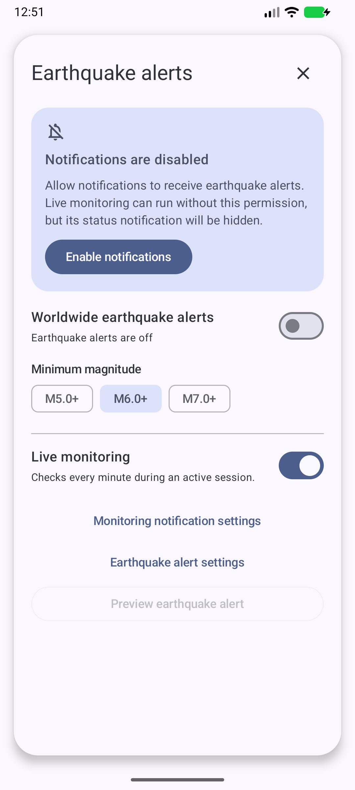](images/walkthrough/compact-notifications.png)

**Expanded**

[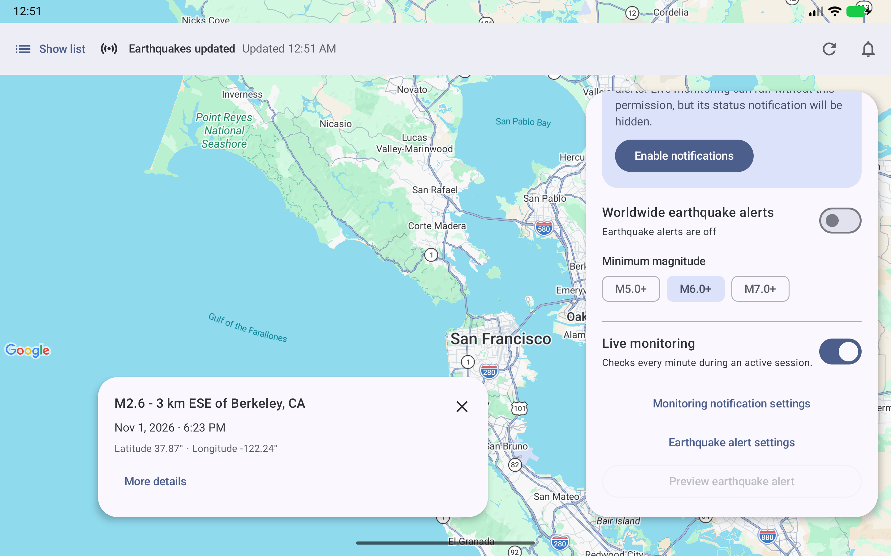](images/walkthrough/expanded-monitoring.png)

## Alerts

Opt into M5+, M6+, or M7+ alerts, preview a notification, and open notification
settings. Alert taps select the corresponding saved event. Delivered events are
recorded to avoid repeated alerts. The captures below show the settings with
notification permission disabled.

Implementation:

- Permission requests and Android settings actions: [EarthquakeNotificationsScreen.kt](../app/src/main/kotlin/com/johnturkson/sandbox/ui/notifications/EarthquakeNotificationsScreen.kt).
- Notification channels, preview, and event intents: [EarthquakeNotifications.kt](../app/src/main/kotlin/com/johnturkson/sandbox/data/notifications/EarthquakeNotifications.kt).
- Magnitude and freshness rules: [EarthquakeAlertPolicy.kt](../app/src/main/kotlin/com/johnturkson/sandbox/data/notifications/EarthquakeAlertPolicy.kt).
- Delivery deduplication: [EarthquakeAlertDelivery.kt](../app/src/main/kotlin/com/johnturkson/sandbox/data/notifications/EarthquakeAlertDelivery.kt).

**Compact**

**Expanded**

[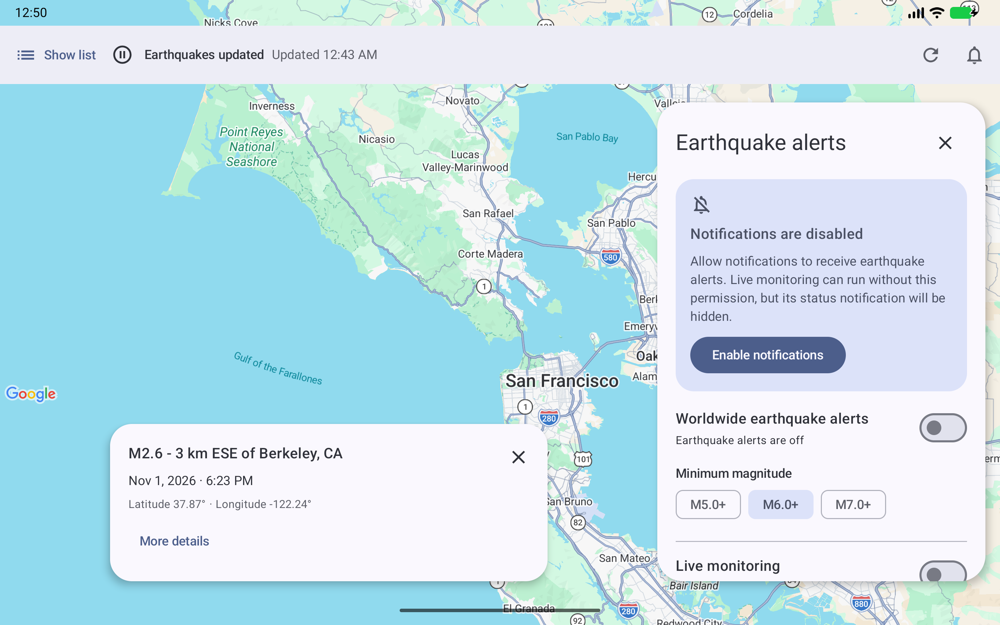](images/walkthrough/expanded-notifications.png)

## Offline access

Saved earthquake information remains readable after reopening without
connectivity. Map, List, and Details observe Room data, and a failed refresh
preserves stored events and the last successful update time. These captures
show saved information after network access was disabled.

Implementation:

- Database and persisted records: [EarthquakeDatabase.kt](../app/src/main/kotlin/com/johnturkson/sandbox/data/database/EarthquakeDatabase.kt).
- Stored-event queries and merges: [EarthquakeDao.kt](../app/src/main/kotlin/com/johnturkson/sandbox/data/database/EarthquakeDao.kt).
- Observable reads used by the destinations: [EarthquakeRepository.kt](../app/src/main/kotlin/com/johnturkson/sandbox/data/repository/EarthquakeRepository.kt).

**Compact**

**Expanded**

## Location

Optionally grant approximate location access and use Locate to center Map.
Browsing earthquakes remains available without that permission. These images
show the Locate control before location access was granted.

Implementation:

- Permission and location lifecycle integration: [EarthquakeScreen.kt](../app/src/main/kotlin/com/johnturkson/sandbox/ui/map/EarthquakeScreen.kt).
- Locate and app-settings control: [EarthquakeLocationButton.kt](../app/src/main/kotlin/com/johnturkson/sandbox/ui/map/location/EarthquakeLocationButton.kt).
- Fused Location Provider updates: [EarthquakeLocationProvider.kt](../app/src/main/kotlin/com/johnturkson/sandbox/data/location/EarthquakeLocationProvider.kt).
- Last known location storage: [EarthquakeLocationRepository.kt](../app/src/main/kotlin/com/johnturkson/sandbox/data/location/EarthquakeLocationRepository.kt).

**Compact**

**Expanded**

## Appearance

Light and dark themes follow the system, with dynamic color where available.
Components also accommodate large text and right-to-left layouts. The captures
below show compact Details and expanded Map and List in dark mode.

Implementation:

- System theme and dynamic color selection: [EarthquakeTheme.kt](../app/src/main/kotlin/com/johnturkson/sandbox/theme/EarthquakeTheme.kt).
- App color values: [Color.kt](../app/src/main/kotlin/com/johnturkson/sandbox/theme/Color.kt).
- Typography: [Type.kt](../app/src/main/kotlin/com/johnturkson/sandbox/theme/Type.kt).

**Compact**

[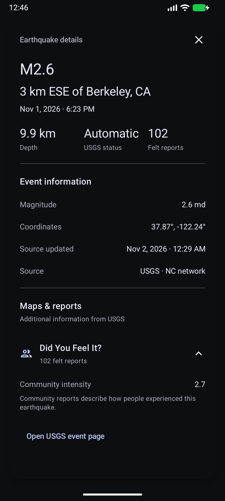](images/walkthrough/compact-dark-details.png)

**Expanded**

[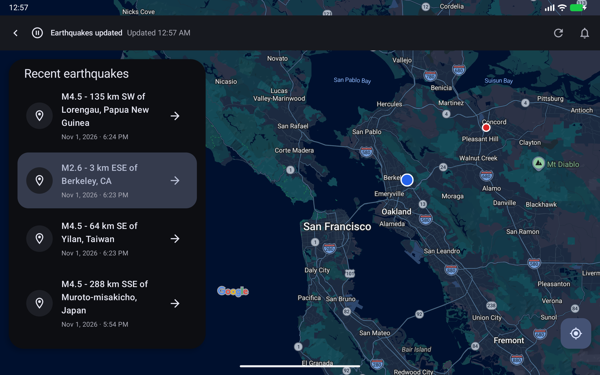](images/walkthrough/expanded-dark-list.png)
